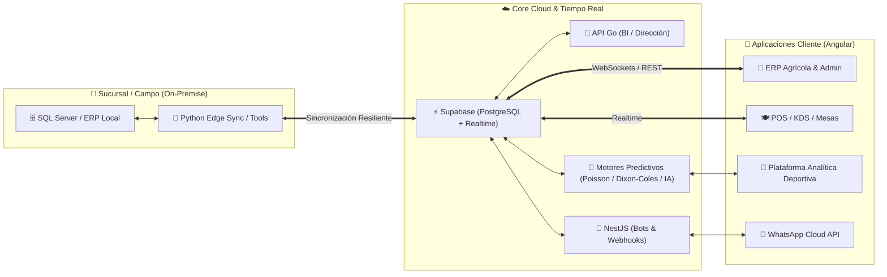

# 👋 ¡Hola! Soy Ing. Eduardo (`@isclalo801`)
### Ingeniero en Sistemas Computacionales | Arquitecto de Software Full-Stack & Consultor de Sistemas Empresariales

---

### 🚀 Sobre mí

Diseño, desarrollo y despliego **ecosistemas de software empresarial en tiempo real de punta a punta**: desde **sistemas ERP a medida para el sector agrícola y agroindustrial**, plataformas de **analítica predictiva y modelos matemáticos para apuestas deportivas**, hasta **suites gastronómicas (POS / KDS / Fidelización)**, microservicios de alta concurrencia, sincronizadores híbridos (**Cloud ↔ On-Premise**) y herramientas de automatización e infraestructura.

> 🔒 **Nota sobre mis repositorios (+78 proyectos y +2,790 contribuciones anuales):**  
> La gran mayoría de mi código se encuentra en **repositorios privados** debido a acuerdos de confidencialidad (NDA) y propiedad intelectual con mis clientes, ya que corresponden a sistemas comerciales, ERPs y plataformas propietarias en operación productiva continua.

---

### 🏗️ Ecosistemas y Soluciones que Construyo en Producción

#### 🌱 1. Sistemas ERP para Empresas Agrícolas y Agroindustriales a Medida
Desarrollo de plataformas integrales adaptadas a la operación real del campo y la agroindustria:
- **Gestión de Ciclos Agrícolas y Lotes:** Control de costos por hectárea, lote, cultivo y temporada, desde la preparación y siembra hasta la cosecha.
- **Insumos, Almacenes y Maquinaria:** Trazabilidad de agroquímicos, fertilizantes, combustibles, mantenimiento de flotillas y órdenes de aplicación.
- **Capital Humano y Nómina Agrícola:** Control de cuadrillas, asistencia en campo, pagos por destajo/jornal, liquidaciones y cumplimiento operativo.
- **Comercialización, Empaque y Finanzas:** Control de báscula, salidas de embarque, cuentas por cobrar/pagar, facturación y reportes ejecutivos de rentabilidad en tiempo real.

#### 🎯 2. Analítica Deportiva Cuantitativa, Modelos Predictivos & IA (`Sports Trading & Betting Engine`)
Arquitectura de una plataforma avanzada de inteligencia estadística y probabilidades para mercados deportivos (**Fútbol Internacional & NFL**):
- **Modelado Matemático y Estadístico:** Implementación de motores **Dixon-Coles** y **Modelos Lineales Generalizados de Poisson (Poisson GLM)** para estimación de goles esperados ($xG$), proyecciones de marcador exacto y distribución de probabilidades reales.
- **Escáner de Valor Esperado (`+EV`) y Rachas:** Detección automatizada de ineficiencias en cuotas de mercado, análisis de rachas históricas y simulación de escenarios.
- **Estrategias Asistidas por IA:** Integración de agentes de juicio probabilístico e inteligencia artificial para evaluación contextual de partidos.
- **Gestión de Bankroll (`My Bank`):** Control matemático de banca, cálculo de *staking*, seguimiento de ROI, *yield* y control de riesgo.

#### 🍽️ 3. Ecosistemas POS, KDS (Kitchen Display System) & Lealtad Omnicanal
Suites multi-aplicación de misión crítica para cadenas restauranteras y comercio minorista:
- **Operación de Piso y Cocina en Tiempo Real:** Sistemas táctiles de alta velocidad en **Angular (Signals)** conectados vía **Supabase Realtime** para comandado en mesas, división de cuentas, cobros móviles y pantallas de preparación en cocina (KDS).
- **Fidelización, E-Commerce & Reparto (PWA):** Monederos electrónicos, catálogos de pedidos en línea, aplicaciones para clientes y logística de repartidores en tiempo real.
- **Sincronización Híbrida Edge (On-Premise ↔ Cloud):** Demonios y servicios resilientes en **Python** que conectan bases de datos locales (**SQL Server / SoftRestaurant**) con la nube (**PostgreSQL / Supabase**) sin interrumpir la operación en sucursal.

#### 📊 4. Suites Directivas (BI), Capital Humano (RH) & Automatización Conversacional
- **Alta Dirección y Recursos Humanos (`ChepeOS`):** Dashboards ejecutivos de auditoría financiera, control de asistencia biométrica/reloj checador, incidencias y nómina respaldados por APIs de alto rendimiento en **Go (Gin)**.
- **Bots Empresariales Oficiales:** Motores conversacionales de atención al cliente, toma de pedidos y notificaciones transaccionales con **NestJS + Fastify** y **WhatsApp Cloud API**.
- **Infraestructura, Redes & Herramientas Desktop:** Aplicaciones nativas en **Python (CustomTkinter)** empaquetadas como ejecutables autónomos para administración de redes VPN (`Radmin VPN`), escaneo multihilo de subredes y gestión automatizada de conexiones **RDP**.

---

### 🛠️ Stack Tecnológico & Herramientas

#### Frontend, UI/UX & Aplicaciones Web (SPA / SSR / PWA)

#### Backend, Microservicios, Modelos Matemáticos & Automatización
-00ADD8?style=for-the-badge&logo=go&logoColor=white)
-E0234E?style=for-the-badge&logo=nestjs&logoColor=white)

#### Bases de Datos, Cloud & Infraestructura Híbrida
-3ECF8E?style=for-the-badge&logo=supabase&logoColor=white)
-316192?style=for-the-badge&logo=postgresql&logoColor=white)

---

### 📐 Arquitectura Típica de mis Ecosistemas

---

### 📈 Estadísticas de Ingeniería y Actividad

  
  

---

### 📫 Contacto y Colaboración

¿Buscas desarrollar un **ERP agrícola o empresarial a medida**, automatizar la operación de tu negocio o construir plataformas de analítica avanzada?

- 💼 **GitHub:** [@isclalo801](https://github.com/isclalo801)
- 📍 **Ubicación:** México 🇲🇽
